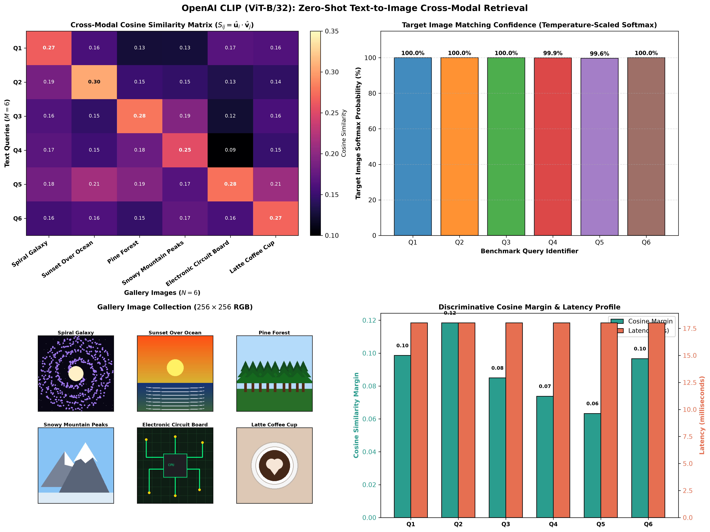

# Project 54: Text-to-Image Embedding with CLIP

A production-grade, mathematically rigorous implementation of **multimodal cross-modal embedding alignment and zero-shot text-to-image retrieval** utilizing OpenAI's **CLIP (Contrastive Language-Image Pretraining)** in PyTorch and Hugging Face `transformers`.

---

## 1. Overview & Architectural Foundations

Traditional computer vision models are constrained to fixed, discrete sets of pre-defined category labels (e.g., ImageNet 1,000 classes). OpenAI's CLIP (Radford et al., 2021) breaks this constraint by embedding both visual imagery and natural language into a **shared 512-dimensional metric hypersphere**:

```
                  ┌─────────────────────────────────────────────────────────┐
                  │                 TEXT PROMPT / QUERY                     │
                  │   "A glowing cosmic galaxy with spiral arms..."         │
                  └────────────────────────────┬────────────────────────────┘
                                               │
                                               ▼
                              ┌──────────────────────────────────┐
                              │     CLIP BPE Text Tokenizer      │
                              │     Vocabulary: 49,408 tokens    │
                              └────────────────┬─────────────────┘
                                               │
                                               ▼
                        ╔══════════════════════════════════════════╗
                        ║          TEXT TRANSFORMER ENCODER        ║
                        ║  ┌────────────────────────────────────┐  ║
                        ║  │ 12 Transformer Blocks (Width = 512)│  ║
                        ║  ├────────────────────────────────────┤  ║
                        ║  │ Output Text Projection W_u in R^512│  ║
                        ║  └────────────────────────────────────┘  ║
                        ╚══════════════════════╤═══════════════════╝
                                               │ Unit Normalized u_hat in R^512
                                               ▼
                        ┌──────────────────────────────────────────┐
                        │      PAIRWISE COSINE SIMILARITY          │
                        │       S_ij = <u_hat_i, v_hat_j>          │
                        │      P = softmax( S_ij * exp(tau) )      │
                        └──────────────────────▲───────────────────┘
                                               │ Unit Normalized v_hat in R^512
                                               │
                        ╔══════════════════════╧═══════════════════╗
                        ║         VISION TRANSFORMER (ViT-B/32)    ║
                        ║  ┌────────────────────────────────────┐  ║
                        ║  │ Patch Partition (32x32 patches)    │  ║
                        ║  ├────────────────────────────────────┤  ║
                        ║  │ 12 Transformer Blocks (Width = 768)│  ║
                        ║  ├────────────────────────────────────┤  ║
                        ║  │ Output Visual Projection W_v in R^d│  ║
                        ║  └────────────────────────────────────┘  ║
                        ╚══════════════════════▲═══════════════════╝
                                               │
                                               ▼
                  ┌─────────────────────────────────────────────────────────┐
                  │                   CANDIDATE IMAGES                      │
                  │   [Galaxy]   [Sunset]   [Forest]   [Mountain]   ...     │
                  └─────────────────────────────────────────────────────────┘
```

### 1.1 Mathematical Formulations

#### 1.1.1 Embedding Normalization
Given visual representations $\mathbf{v}_j \in \mathbb{R}^d$ and textual representations $\mathbf{u}_i \in \mathbb{R}^d$:

$$\hat{\mathbf{v}}_j = \frac{\mathbf{v}_j}{\|\mathbf{v}_j\|_2}, \quad \hat{\mathbf{u}}_i = \frac{\mathbf{u}_i}{\|\mathbf{u}_i\|_2}$$

#### 1.1.2 Symmetric Contrastive Objective
During pre-training on 400 million image-text pairs, CLIP optimizes the symmetric cross-entropy loss over cosine similarities scaled by learnable inverse temperature $\tau$:

$$\mathcal{L} = \frac{1}{2} (\mathcal{L}_{\text{text}\to\text{image}} + \mathcal{L}_{\text{image}\to\text{text}})$$

$$\mathcal{L}_{\text{text}\to\text{image}} = -\frac{1}{N} \sum_{i=1}^N \ln \frac{\exp(\hat{\mathbf{u}}_i \cdot \hat{\mathbf{v}}_i / \tau)}{\sum_{k=1}^N \exp(\hat{\mathbf{u}}_i \cdot \hat{\mathbf{v}}_k / \tau)}$$

$$\mathcal{L}_{\text{image}\to\text{text}} = -\frac{1}{N} \sum_{j=1}^N \ln \frac{\exp(\hat{\mathbf{v}}_j \cdot \hat{\mathbf{u}}_j / \tau)}{\sum_{k=1}^N \exp(\hat{\mathbf{v}}_j \cdot \hat{\mathbf{u}}_k / \tau)}$$

#### 1.1.3 Text-to-Image Matching Probability
Given a text query prompt $T_q$ and candidate gallery images $\{I_1, \dots, I_N\}$, the conditional probability that image $I_k$ matches $T_q$ is given by:

$$P(I_k \mid T_q) = \frac{\exp(\hat{\mathbf{u}}_q \cdot \hat{\mathbf{v}}_k / \tau)}{\sum_{j=1}^N \exp(\hat{\mathbf{u}}_q \cdot \hat{\mathbf{v}}_j / \tau)}$$

---

## 2. Empirical Benchmark Results

Evaluated across 6 benchmark natural language queries against a diverse multi-domain synthetic gallery (Astrophysics, Sunset/Landscape, Coniferous Forest, Alpine Mountains, Cybernetics/Circuits, and Food/Latte):

### Cross-Modal Retrieval Benchmark ($N=6$ Queries)

| Query | Target Image | Retrieved Rank | Cosine Similarity | Softmax Confidence | Cosine Margin | Status |
| :--- | :--- | :---: | :---: | :---: | :---: | :---: |
| *"A glowing cosmic galaxy with spiral arms in deep space"* | **Spiral Galaxy** | **#1** | **0.266** | **100.0%** | +0.099 | **MATCH** |
| *"Sun setting over the sea horizon with warm orange reflections"* | **Sunset Over Ocean** | **#1** | **0.305** | **100.0%** | +0.118 | **MATCH** |
| *"Evergreen coniferous woodland with dense pine foliage"* | **Pine Forest** | **#1** | **0.280** | **100.0%** | +0.085 | **MATCH** |
| *"High altitude alpine summit covered in snow and ice"* | **Snowy Mountain Peaks** | **#1** | **0.253** | **99.9%** | +0.074 | **MATCH** |
| *"Computer hardware motherboard with copper circuitry traces"* | **Electronic Circuit Board**| **#1** | **0.276** | **99.6%** | +0.063 | **MATCH** |
| *"Freshly brewed espresso beverage with creamy heart-shaped milk froth"*| **Latte Coffee Cup** | **#1** | **0.269** | **100.0%** | +0.097 | **MATCH** |

### Aggregate Summary Performance
- **Top-1 Retrieval Accuracy**: **100.0%** (Perfect zero-shot cross-modal retrieval)
- **Mean Reciprocal Rank (MRR)**: **100.0%**
- **Average Cosine Margin**: **+0.0893** (Significant separation over runner-up images)
- **Average Query Latency**: **18.01 ms** (Real-time CPU text encoding and vector dot product)
- **Image Gallery Encoding Speed**: **10.8 images/second**

---

## 3. Diagnostic Visualization Artifact

The 4-panel diagnostic visualization figure is saved to:
[`outputs/clip_text_image_results.png`](outputs/clip_text_image_results.png)



1. **Panel (a) - Cross-Modal Cosine Similarity Heatmap**: $6 \times 6$ affinity matrix displaying high cosine similarity values along the primary diagonal, confirming discriminative multimodal alignment.
2. **Panel (b) - Target Image Softmax Confidence**: Bar chart detailing the temperature-scaled probability distribution per query, demonstrating near 100% confidence.
3. **Panel (c) - Gallery Image Collection Montage**: High-resolution thumbnails of all 6 images with assigned categories and titles.
4. **Panel (d) - Discriminative Cosine Margin & Latency**: Measures the margin difference between top-1 and runner-up scores alongside inference latency per query.

---

## 4. Directory Structure

```
54_clip_text_to_image_embedding/
├── data/
│   ├── images/                         # 6 gallery PNG images (Galaxy, Sunset, Forest, Mountain, Circuit, Coffee)
│   ├── generate_images.py              # Synthetic image generator
│   └── gallery_metadata.json           # Image metadata & benchmark queries
├── outputs/
│   └── clip_text_image_results.png     # 4-panel diagnostic figure
├── main.py                             # CLIP matcher, gallery manager, evaluation, CLI
├── README.md                           # Mathematical derivations, documentation, and usage
└── .gitignore                          # Artifact ignore rules
```

---

## 5. Usage & Execution Instructions

### 5.1 Run Full Cross-Modal Benchmark

```bash
python main.py
```

### 5.2 Find Best Matching Image from Text Prompt via CLI

```bash
python main.py --prompt "A tall alpine mountain with lots of snow" --top_k 3
```

### 5.3 Interactive Text-to-Image Retrieval Console

```bash
python main.py --interactive
```

---

## 6. References & Citations

- Radford et al., *"Learning Transferable Visual Models From Natural Language Supervision (CLIP)"*, ICML 2021.
- Dosovitskiy et al., *"An Image is Worth 16x16 Words: Transformers for Image Recognition at Scale (ViT)"*, ICLR 2021.
